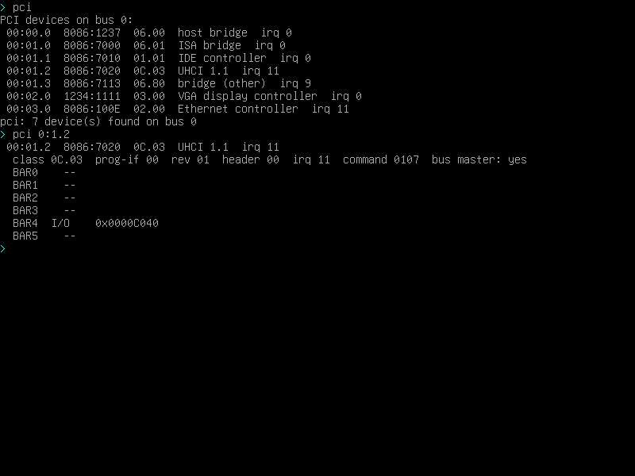

# PCI:怎么知道机器上插了什么

USB 键盘、网卡这些东西在 x86 上都不是"固定的端口",而是挂在 **PCI 总线**上的。
想写 USB 驱动,第一件事就是先把总线枚举出来:找到 USB 控制器、读它的寄存器窗口。
JoyOS 的 `kernel/pci.asm` 就干这一件事,开机扫一遍,shell 里用 `pci` 看。

## 机制 #1:两个端口搞定配置空间

PCI 设备内部有一块 256 字节的"配置空间"(前 64 字节是标准头)。访问它只要两个 I/O 端口:

| 端口 | 干什么 |
|---|---|
| `0xCF8` | 写 32 位"地址":bit31 = 1(开),bit16~23 = 总线号,bit11~15 = 设备号,bit8~10 = 功能号,bit0~7 = 寄存器偏移(4 字节对齐) |
| `0xCFC` | 读写 32 位数据 |

所以读一个寄存器就三步:拼地址 → `out 0xCF8` → `in 0xCFC`。
**最容易踩的坑是忘了 bit31**:忘了它 CPU 根本不发起配置周期,读回来全是 0,
而且不报错(§6.26)。

## 扫总线:别忘了"兄弟功能"

枚举顺序:总线 0 → 设备 0~31 → 每个设备的 功能 0~7。

- 先读 offset 0 的 32 位:**厂商号 0xFFFF = 这里没设备**(空槽位返回的是 0xFFFF,不是 0)。
- 有设备就读 offset 0x0C 的 header type;**bit7 = 1 说明是"多功能设备"**,
  这时候 func 1~7 都要扫 —— 机器上的 IDE(00:01.1)、USB(00:01.2)就是 ISA 桥(00:01.0)
  的功能,只扫 func 0 会一个都看不见(§6.27)。

设备名里那串 `8086:7010` 就是"厂商号:设备号"(8086 = Intel)。类别号(offset 0x0B/0x0A,
比如 `01.01` = IDE、`0C.03` = USB UHCI、`03.00` = 显卡)用来认它是什么东西。

## BAR:设备的寄存器窗口

设备头里 offset 0x10 起有 6 个 **BAR(Base Address Register)**,每个 4 字节:

- 读它的**低位**就知道是内存窗口还是 I/O 窗口:`bit0 = 1` = I/O 端口,`= 0` = 内存地址。
- 想要**大小**:把这个 BAR 写全 1、再读回来,不受影响的那些位就是"设备要用的位",
  反推即可(内存 BAR 还要清掉低 4 位的标志位)。量完把原值写回去。
  ⚠️ 我们**只这么量内存 BAR**:实测拿 I/O BAR 这么干一次,整台 QEMU 的配置空间
  都会变得读不动(§6.32),而 I/O BAR 的基址已经够用了。

## 命令怎么用

```
> pci
 00:00.0  8086:1237  06.00  host bridge  irq 0
 00:01.0  8086:7000  06.01  ISA bridge  irq 0
 00:01.1  8086:7010  01.01  IDE controller  irq 0
 00:01.2  8086:7020  0C.03  UHCI 1.1  irq 11
 00:01.3  8086:7113  06.80  bridge (other)  irq 9
 00:02.0  1234:1111  03.00  VGA display controller  irq 0
 00:03.0  8086:100E  02.00  Ethernet controller  irq 11
pci: 7 device(s) found on bus 0

> pci 0:1.2
 00:01.2  8086:7020  0C.03  UHCI 1.1  irq 11
 class 0C.03  prog-if 00  rev 01  header 00  irq 11  command 0107  bus master: yes
 BAR0    --
 BAR1    --
 BAR2    --
 BAR3    --
 BAR4  I/O    0x0000C040
 BAR5    --
```

地址写法是 `总线:设备.功能`,认不出来(比如写了不存在的设备)会直接告诉你。



## 以后要往哪走

| 步 | 干什么 | 会踩什么 |
|---|---|---|
| ① PCI 枚举 | ✅ 已经能列出设备、读 BAR | bit31、多功能设备、0xFFFF(§6.26~6.29) |
| ② UHCI 初始化 | 打开控制器:复位、把帧列表(1024 项)和异步队列头挂上去 | 那是**物理地址**,得放在恒等映射的 16 MiB 里 |
| ③ EP0 控制传输 | 8 字节的 SETUP 包 + 数据 + 握手,这是第一次真的"发 DMA" | 缓冲区必须**物理连续**;USB 是**小端**,描述符要按位拆 |
| ④ HID 键盘 | 中断传输 + 轮询:键码在"报告"里,不是 PS/2 扫描码 | 报告长度不同、修饰键是 bitmask,得单独做一张翻译表 |
| ⑤ EHCI / 大容量存储 | 高速设备 + SCSI 子集(读块要走 CBW/CSW) | 是"每一帧一大串描述符",和 UHCI 的差别很大 |

好消息是 x86 PC 上**不需要管缓存一致性**:CPU 和 PCI 共用同一块物理内存,
DMA 缓冲区只要在恒等映射的 16 MiB 之内就直接能读能写。

## 现在的限制

- 只扫 **bus 0**:桥后面(比如 PCIe 后面)的总线看不到
- 中断号只读得出来,**IDT 里还没有对应的门**,所以 USB 现在只能轮询
- I/O BAR 不给大小(原因见 §6.32);个别内存 BAR 会偏大(VGA 的 BAR2 我们量出 64 KiB,
  QEMU 的 `info pci` 说 4 KiB)
- 配置空间只读不改:枚举时只会打开 I/O / MMIO / Bus Master 三个开关
